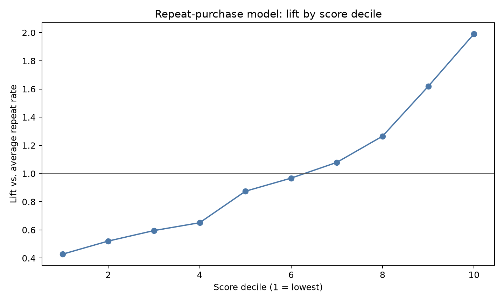
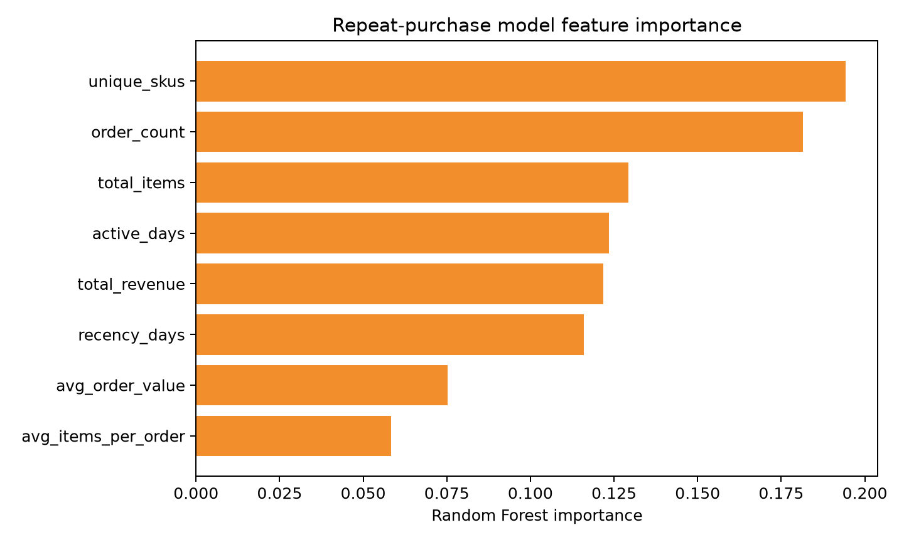
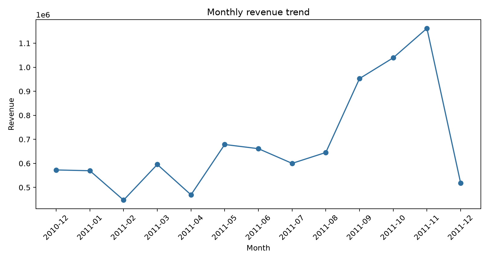
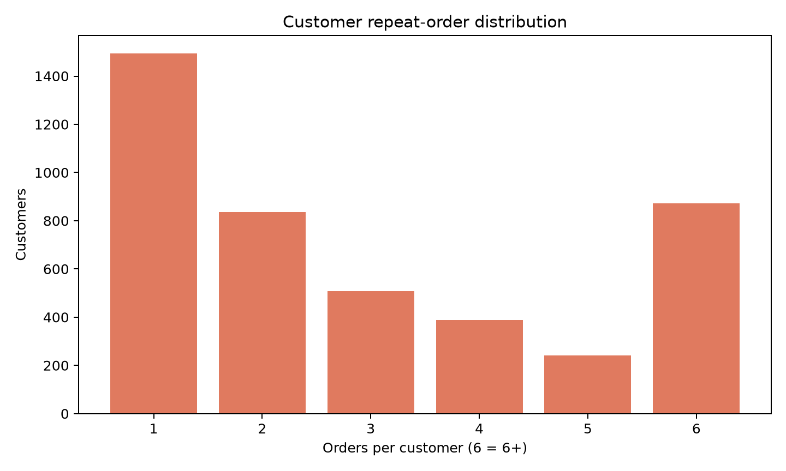
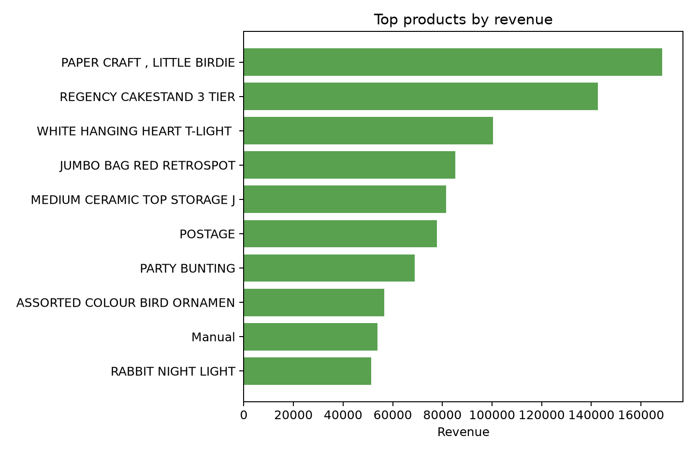
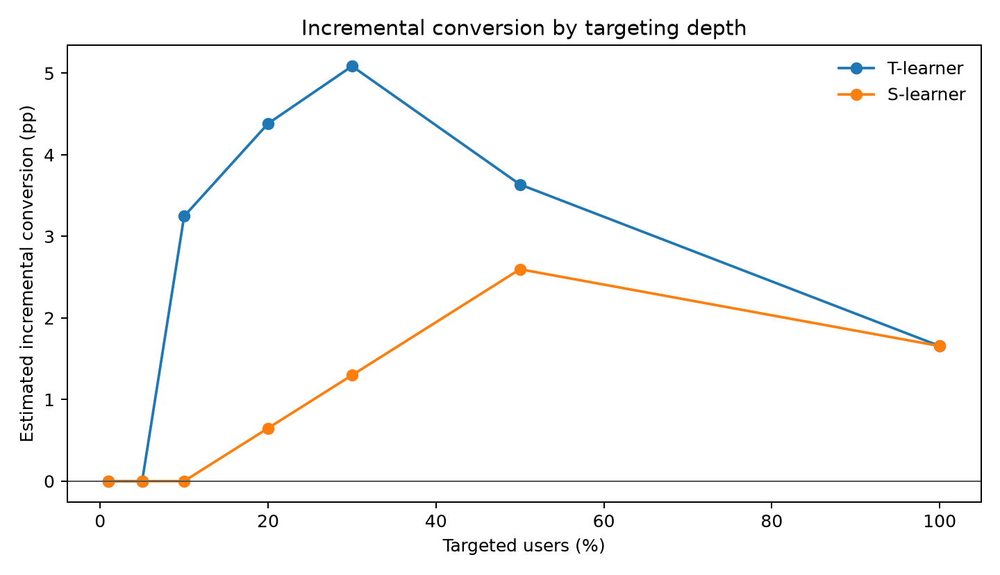
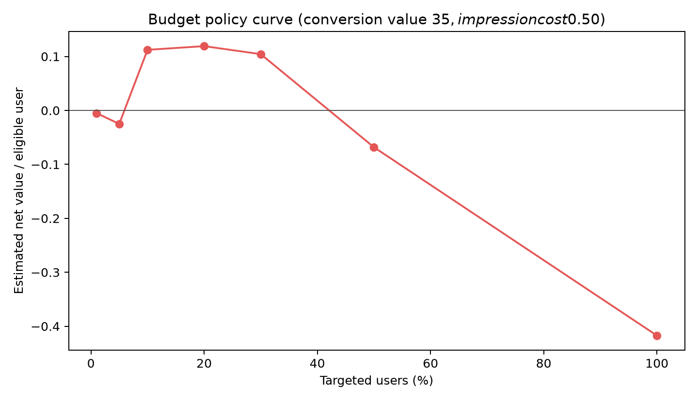
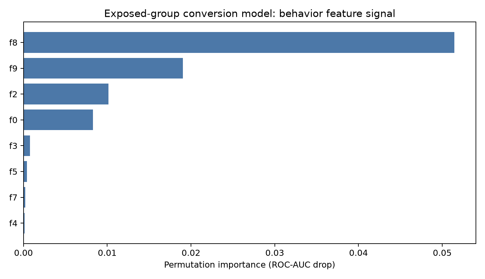

# 电商用户增长增量实验与机器学习分层系统

**E-commerce Growth Incrementality & Uplift Decision System**

这是一个面向互联网大厂电商数据科学、数据分析和增长运营岗位的可复现项目。项目回答一个具体的业务问题：**当平台有固定商品促销与用户触达预算时，应该把资源投给谁，才能带来更多“额外”的商品访问和购买转化？**

简历可直接使用的项目介绍见：[resume_project_entry.md](resume_project_entry.md)。

项目把问题拆成三层：

1. **是否有效**：用随机实验估计商品促销触达对商品访问、购买转化的 ITT（Intent-to-Treat）增量，并检查实验分流是否可信。
2. **谁有效**：用 S-learner 和 T-learner（Random Forest）估计用户层面的 CATE/uplift，区分“触达后才会购买”的增量用户与本来就会购买的用户。
3. **投多少人**：用 IPW 评估 5%/10%/20%/30%/50% 人群策略，在触达成本与增量购买价值的情景假设下输出预算曲线。

## 数据与边界

项目使用两类公开数据。第一类是 [UCI Online Retail](https://archive.ics.uci.edu/dataset/352/online-retail) 订单数据，用于商品、客户、GMV、客单价和复购分析；第二类是 [Criteo Uplift Prediction Dataset](https://ailab.criteo.com/criteo-uplift-prediction-dataset/)，用于随机触达实验、增量效果和 CATE/uplift 建模。在 Criteo 数据中，visit 作为商品访问代理、conversion 作为购买转化代理。订单数据是观察性数据，复购差异不能直接解释为促销因果效果；因果结论继续由随机实验模块负责。

UCI 数据按 CC BY 4.0 发布，Criteo benchmark 按其数据许可发布。f0–f11 是匿名特征，不能解释成具体商品或用户标签；项目把两类数据分别用于“电商经营分析”和“增量决策”，避免把观察性订单数据误写成因果结果。

## 电商经营分析结果

运行 `python scripts/analyze_ecommerce.py` 后，项目会从订单明细生成订单表、客户指标表和商品排行：

- 清洗后订单 **18,532 笔**，客户 **4,338 人**，商品 SKU **3,665 个**。
- 清洗后 GMV **£8.91M**，平均客单价 **£480.87**。
- 订单数不少于 2 笔的复购客户占比 **65.6%**；该指标用于经营分层，不直接作为促销因果结论。

### 复购预测模型

以 2011-10-10 为时间切分点，仅使用切分日前的订单行为构建客户特征，预测未来 60 天是否复购。Random Forest 在留出集上的 ROC-AUC 为 **0.755**、PR-AUC 为 **0.776**；预测分数最高的 10% 客户复购率为 **95.5%**，相对整体提升 **1.99x**。该模型用于运营优先级排序，优惠券或推荐位的真实增量仍需随机 holdout 验证。





### 可视化结果







## 增量模型结果

随机触达模块将商品访问作为主要优化指标，输出模型排序后的增量曲线、预算策略价值和特征重要性：







## 结果摘要（本仓库样本）

运行 `python scripts/run_analysis.py` 后，结果写入 `reports/`：

- 3,000 行跨分片样本，触达组占比 73.33%；商品访问率 3.97%，购买转化率 0.17%。
- 全量商品触达对访问的 ITT 为 **+2.00pp**（95% CI **+0.61pp 至 +3.39pp**）。
- T-learner 选取预测增量最高的 10% 用户，测试集 IPW 估计增量访问 **+3.25pp**（约 **32.5 次/1,000 个目标用户**）。在“每次增量商品访问价值 $5、每次触达成本 $0.50”的情景假设下，净价值约 **$0.112/合格用户**。
- 转化在这个 3,000 行样本中很稀疏，10% 策略没有足够事件支持稳定估计，因此只作为 guardrail；线上使用前必须扩大样本并保留 holdout。

这些数字是一次可复现的公开样本运行结果，不应被写成平台线上收益。真正上线时需要用平台自己的曝光成本、订单毛利、频控和人群特征重新校准。

## 目录

```text
data/sample/                         可复现的公开样本（不含内部数据）
data/ecommerce/                      UCI Online Retail 订单数据
scripts/fetch_hf_sample.py           从公开数据服务拉取样本
scripts/download_uci_retail.py       下载 UCI 订单数据
scripts/analyze_ecommerce.py         生成客户、订单、商品指标和电商图表
scripts/train_repeat_purchase_model.py 训练未来 60 天复购预测模型
scripts/run_analysis.py              训练模型、估计 uplift、生成结果图
sql/01_funnel_metrics.sql            SQL 漏斗与 ITT 查询
sql/02_policy_segments.sql           预算分层查询模板
prompts/analysis_copilot.md          Codex/Claude 分析工作流提示词
reports/decision_memo.md             决策备忘录
reports/figures/                     uplift、策略价值、特征重要性图
reports/ecommerce_figures/           GMV、复购和商品排行图
reports/repeat_purchase_model_memo.md 复购预测模型结果
```

## 运行

```powershell
python -m pip install -r requirements.txt
python scripts/download_uci_retail.py
python scripts/analyze_ecommerce.py
python scripts/train_repeat_purchase_model.py
python scripts/fetch_hf_sample.py
python scripts/run_analysis.py
```

如果需要扩大样本，把 `scripts/fetch_hf_sample.py` 中的随机 offset 数量调大，或下载 Criteo 原始压缩包后替换输入文件；分析脚本会自动生成模型对比、策略曲线、特征重要性和决策备忘录。

## 面试可讲的分析链路

- **业务拆解**：北极星指标是增量商品访问/购买；驱动指标是触达覆盖、频控、商品访问率；护栏指标是触达成本、自然购买被重复触达的比例和实验 holdout 差异。
- **因果推断**：先看随机化与 treatment 比例，再算 ITT 和置信区间；用户分层使用 IPW uplift 曲线，不把相关性写成因果。
- **机器学习**：S-learner 作为基线，T-learner 让 treatment/control 分别拟合，用 Qini/uplift@k 和策略价值比较模型，而不是只看 AUC。
- **落地**：以 10% 小流量策略做线上 holdout，按周重训分层模型；只有当增量动作和净价值都稳定时，才扩大预算。
